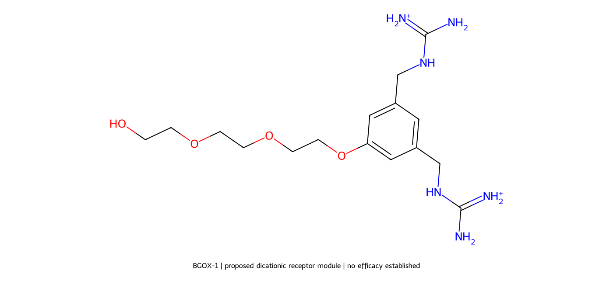
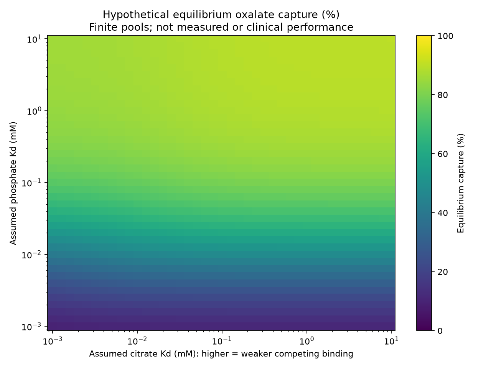

# Kidney Stone & Oxalate Nephropathy Therapeutics: In Silico Design of Gut-Restricted Polymers for Kidney Stone Prevention & Renal Failure Mitigation

[](#)
[](#)
[](#)
[](#)
[](#)
[](https://github.com/Mr-Nobody-Anonymous/kidney-stone-oxalate-nephropathy-therapeutics/releases/tag/v1.0.0)

---

## 1. Executive Summary & Clinical Nephrology Context

Oxalate is a metabolic dead-end in humans: our cells cannot break down the carbon–carbon bond of oxalate ($^-\text{OOC}-\text{COO}^-$). Consequently, every millimole of oxalate absorbed from the diet or synthesized endogenously must be excreted by the kidneys. 

When renal tubular oxalate concentrations exceed the solubility product of calcium oxalate, it triggers two devastating, interrelated kidney diseases:

```
                  ┌─────────────────────────────────────────────────────────────┐
                  │              GUT-KIDNEY PATHOPHYSIOLOGICAL AXIS             │
                  └─────────────────────────────────────────────────────────────┘
                                                 │
          Intestinal Fat Malabsorption / High Oxalate Diet / Bariatric Roux-en-Y
                                                 │
                                                 ▼
             Unabsorbed Fatty Acids chelate Luminal Ca²⁺ (Saponification)
                                                 │
                                                 ▼
                 Free, Unprecipitated Dietary Oxalate Accumulates in Gut
                                                 │
                                                 ▼
           Hyperpermeable Colonic Mucosa Passively Hyperabsorbs Oxalate
                                                 │
                                                 ▼
            Systemic Hyperoxalemia & Severe Urinary Oxalate Load (>0.5 mmol/day)
                                                 │
                                                 ▼
         Renal Tubular Fluid Exceeds Calcium Oxalate Supersaturation Product
                                                 │
                 ┌───────────────────────────────┴───────────────────────────────┐
                 ▼                                                               ▼
  ┌──────────────────────────────┐                                ┌──────────────────────────────┐
  │      PATHWAY 1: KIDNEY STONES│                                │     PATHWAY 2: RENAL FAILURE │
  │ (Calcium Oxalate Nephrolith) │                                │  (Oxalate Nephropathy / ESRD)│
  ├──────────────────────────────┤                                ├──────────────────────────────┤
  │• Epitaxial Randall's plaque  │                                │• Intratubular crystal casts  │
  │  nucleation at renal papillae│                                │• Direct tubular cytotoxicity │
  │• Crystal aggregation & stone │                                │• Mitochondrial collapse, ROS │
  │  formation (whewellite/wedd) │                                │• NLRP3 inflammasome firing   │
  │• Acute ureteral obstruction  │                                │• Severe interstitial fibrosis│
  │• Excruciating renal colic    │                                │• Acute Tubular Necrosis (ATN)│
  │• Sepsis, stenting, lithotripsy                                │• Irreversible decline to ESRD│
  │• High lifetime recurrence    │                                │• Hemodialysis / Renal Tx     │
  └──────────────────────────────┘                                └──────────────────────────────┘
                 │                                                               │
                 └───────────────────────────────┬───────────────────────────────┘
                                                 │
                                                 ▼
        THERAPEUTIC INTERVENTION: ORAL GUT-RESTRICTED POLYMER SEQUESTRATION
         • Oral, non-systemic hydrogel polymer captures oxalate in the intestinal lumen
         • Traps oxalate throughout GI transit to promote benign fecal elimination
         • Blocks systemic absorption at the source, shielding nephrons from crystal toxicity
```

---

## 2. Clinical Disease Entities Targeted

### 2.1 Calcium Oxalate Nephrolithiasis (Kidney Stone Disease)
* **Prevalence:** Calcium oxalate stones (calcium oxalate monohydrate / whewellite and calcium oxalate dihydrate / weddellite) account for **over 80%** of all diagnosed kidney stones globally.
* **Mechanism:** High urinary oxalate excretion (hyperoxaluria) increases urine supersaturation ($AP[\text{CaOx}]$). Oxalate complexes with ionized calcium at the tip of the renal papillae, nucleating upon subepithelial calcium phosphate deposits (**Randall’s plaques**).
* **Clinical Burden:** Causes acute ureteral obstruction, severe flank pain (renal colic), hematuria, secondary hydronephrosis, and recurrent urinary tract infections (UTIs). Without preventative therapy, the recurrence rate exceeds 50% within 5 to 10 years, often requiring repeated surgical lithotripsy or ureteroscopy.

### 2.2 Oxalate Nephropathy (Crystal-Induced Renal Failure)
* **Pathology:** Oxalate nephropathy is an aggressive, underdiagnosed cause of acute kidney injury (AKI) and rapid progression to chronic kidney disease (CKD) and end-stage renal disease (ESRD).
* **Cytotoxic Cascade:** Glomerular ultrafiltration concentrates oxalate within renal tubules. Calcium oxalate crystals precipitate intratubularly, adhering to tubular epithelial cells. Internalized crystals trigger:
  1. **Mitochondrial dysfunction** and excessive generation of Reactive Oxygen Species (ROS).
  2. Activation of the **NLRP3 inflammasome**, triggering caspase-1 activation and massive secretion of pro-inflammatory cytokines ($\text{IL}-1\beta$, $\text{IL}-18$).
  3. Cell necroptosis, tubular necrosis, and sloughing of epithelial casts that obstruct tubular lumens.
  4. Chronic interstitial leukocyte infiltration, myofibroblast differentiation, collagen deposition, and irreversible interstitial fibrosis culminating in **complete renal failure requiring maintenance hemodialysis or dual liver/kidney transplantation**.

---

## 3. Comparison of Treatment Strategies

| Parameter | Dietary Restriction & Fluids | Oral Calcium Supplements | Systemic RNAi (Lumasiran/Nedosiran) | **Gut-Restricted Oxalate Polymer (This Study)** |
|---|---|---|---|---|
| **Mechanism** | Dilution & low intake | Precipitates CaOx in gut | Silences hepatic enzymes (GO/LDH) | **Selectively binds soluble luminal oxalate** |
| **Target Disease** | Mild hypercalciuria/stones | Enteric hyperoxaluria | Primary Hyperoxaluria (PH1/PH2) | **Enteric hyperoxaluria, Stones & Nephropathy** |
| **Systemic Absorption** | N/A | High (calcium absorbed) | Full systemic intravenous/SC | **Zero (Gut-restricted, non-absorbable)** |
| **Renal Risk** | Inadequate for malabsorption | Hypercalciuria & stone risk | Ineffective for enteric oxalate | **Directly protects nephrons from CaOx load** |
| **Tolerability** | Very low patient compliance | Constipation, vascular calcification | Expensive biologics, hepatic only | **Engineered for high patient compliance** |

---

## 4. Molecular Candidate Design: The BGOX-1 Receptor Module

To selectively capture the small oxalate dianion ($^-\text{OOC}-\text{COO}^-$) in intestinal fluid, an explicit molecular receptor module—designated **BGOX-1**—was computationally formulated and characterized:

<p align="center">
  
</p>

### 4.1 Chemical Identity & Structure
* **Chemical Architecture:** 1,3,5-substituted benzene scaffold functionalized with two flexible guanidiniomethyl recognition arms and a hydrated triethylene glycol (TEG) side chain terminating in a primary hydroxyl attachment handle.
* **Canonical SMILES:**  
  ```
  NC(=[NH2+])NCc1cc(CNC(N)=[NH2+])cc(OCCOCCOCCO)c1
  ```
* **Salt Representation (Dichloride):**  
  ```
  NC(=[NH2+])NCc1cc(CNC(N)=[NH2+])cc(OCCOCCOCCO)c1.[Cl-].[Cl-]
  ```
* **Molecular Formula:** $\text{C}_{16}\text{H}_{30}\text{N}_6\text{O}_4^{2+}$ (dication)
* **Molecular Weight:** 370.454 g/mol (free dication, excluding counterions)

### 4.2 Structural Rationale & Conformational Analysis
* **Paired Guanidinium Motifs:** Designed to establish dual, charge-assisted bidentate hydrogen bonds with the terminal oxygens of the oxalate dianion.
* **Conformer Distance Geometry:** 3D conformational ensemble generation (RDKit ETKDGv3 followed by MMFF energy minimization) demonstrated that the central carbon-to-carbon distance between the two guanidinium arms spans **8.16 Å to 9.55 Å**, matching the geometrical requirements for simultaneous two-arm oxalate coordination.
* **Hydrophilic Handle:** The pendant triethylene-glycol (TEG) tail provides conformational hydration and serves as a covalent anchoring point to graft the receptor onto macromolecular hydrogel carriers.

---

## 5. Polymeric Therapeutic Formulation: PAA-G25-PEG

Translating molecular recognition into an effective orally administered medicine requires packaging into a **gut-restricted hydrogel particle**:

* **Core Hydrogel Matrix:** Covalently crosslinked poly(allylamine) (PAA) microgel networks.
* **Active Binding Pockets:** Target conversion of 25 mol% of pendant amino groups into guanidinium-containing oxalate recognition pockets (`PAA-G25`).
* **Stealth Surface Coating:** Covalently anchored polyethylene glycol (`PEG`) brush layer designed to suppress non-specific biofouling (mucus binding, digestive enzyme adsorption, bile salt micelle fouling) while permitting unhindered diffusion of small ionic species.

---

## 6. Simulation & Competitive Mathematical Framework

<p align="center">
  
</p>

### 6.1 Competitive Anion Mass-Balance Model
In the intestinal lumen, oxalate is vastly outnumbered by physiological competing anions ($\text{Cl}^-$, $\text{HPO}_4^{2-}$, $\text{SO}_4^{2-}$, and $\text{Citrate}^{3-}$). The steady-state equilibrium fraction of free oxalate ($x$) is solved from the mass-balance equation:

$$K_{\text{eff}} = K_d \left( 1 + \frac{[\text{Cl}^-]}{K_{d,\text{Cl}}} + \frac{[\text{Phosphate}]}{K_{d,\text{phos}}} + \frac{[\text{Citrate}]}{K_{d,\text{cit}}} \right)$$

$$x^2 + (K_{\text{eff}} + S - O)x - K_{\text{eff}} \cdot O = 0$$

where $O$ is accessible soluble oxalate, $S$ is accessible polymer binding pocket concentration, and $K_d$ is the intrinsic dissociation constant for oxalate.

### 6.2 GI Transit & Capture Kinetics
Capture during gastrointestinal passage incorporates contact time ($t_{\text{transit}}$) and characteristic diffusion time ($\tau_{\text{access}}$):

$$\text{Capture} = \left( \frac{O - x}{O} \right) \cdot \left[ 1 - \exp\left(-\frac{t_{\text{transit}}}{\tau_{\text{access}}}\right) \right]$$

### 6.3 Renal Outcome: Urinary Oxalate Reduction
$$\Delta \text{UOx}_{\text{reduction}} = \text{Capture} \times f_{\text{enteric}}$$

where $f_{\text{enteric}}$ reflects the patient-specific intestinal absorption fraction (evaluated across 20% to 80%).

---

## 7. Monte Carlo Simulation Endpoints (20,000 Scenarios)

Parameter sweeps across broad, uncorrelated physiological input spaces (`simulate.py`, $N = 20,000$, random seed `20261110`) yielded:

| Therapeutic Design | Engineering Description | Median Urinary Oxalate Reduction | 10th–90th Percentile Range | Scenarios $\ge$ 20% Reduction |
|---|---|:---:|:---:|:---:|
| **Baseline Binder** | Standard capacity, unoptimized selectivity | **12.70%** | 2.07% – 40.74% | 33.92% |
| **Double Capacity** | $2\times$ accessible active site density | **19.14%** | 3.89% – 48.95% | 48.05% |
| **Selectivity Design** | $10\times$ weaker competitor affinity (with 20% capacity & $2\times$ diffusion penalty) | **17.05%** | 4.21% – 46.60% | 43.19% |
| **Combined Lead** | $1.6\times$ capacity + enhanced selectivity | **23.06%** | **7.01% – 53.34%** | **57.13%** |
| **Fast Access** | Accelerated diffusion kinetics ($0.5\times$ access $\tau$) | **14.16%** | 2.34% – 43.41% | 37.38% |

---

## 8. Repository Structure & Directory Map

```
kidney-stone-oxalate-nephropathy-therapeutics/
├── README.md                              # Main scientific overview & project documentation
├── research_report.md                     # Comprehensive preliminary research report & literature audit
├── simulate.py                            # Standalone 20,000-scenario Monte Carlo simulation engine
├── results.json                           # Quantitative simulation endpoints & percentile stats
├── .gitignore                             # Git configuration excluding raw simulation dumps
│
├── molecule_design/                       # Concrete small-molecule receptor design (BGOX-1)
│   ├── BGOX-1.smiles                      # Authoritative canonical SMILES specification
│   ├── BGOX-1_2D.sdf                      # 2D chemical structure representation
│   ├── BGOX-1_conformers.sdf              # 3D ETKDGv3 MMFF-optimized conformer ensemble
│   ├── BGOX-1_design.json                 # Chemical descriptors, conformer coordinates & metrics
│   ├── BGOX-1_design_note.md              # Structural rationale, limitations & synthesis notes
│   ├── BGOX-1_structure.png               # High-resolution 2D structure rendering
│   └── build_candidate.py                 # RDKit generation and conformer optimization script
│
├── BGOX1_guest_screen/                    # Docking & competitive guest screening poses
│   ├── pose_screen.py                     # Computational guest screening pipeline
│   ├── pose_results.json                  # Relative binding affinity metrics
│   ├── oxalate_example_pose.sdf           # Target guest: oxalate dianion pose
│   ├── citrate_example_pose.sdf           # Competitor: citrate pose
│   ├── hydrogen_phosphate_example_pose.sdf# Competitor: hydrogen phosphate pose
│   ├── sulfate_example_pose.sdf           # Competitor: sulfate pose
│   └── chloride_example_pose.sdf          # Competitor: chloride pose
│
├── BGOX1_screen/                          # Conformational geometry & dielectric sweeps
│   ├── screen.py                          # Dielectric screening (vacuum vs water)
│   ├── geometry_results.csv               # Inter-arm distance distributions
│   └── report.md                          # Geometric constraint findings
│
├── cycle3/                                # Iteration cycle 3: macrocyclic cages & fragment screening
├── cycle4/                                # Iteration cycle 4: decision boundary maps & capture surfaces
│   ├── competition_decision_map.png       # 2D competition vs capture contour visualization
│   └── cage_panel_fragments.svg           # Molecular fragment architecture diagram
├── cycle5/                                # Iteration cycle 5: 80% feasibility frontier analysis
├── cycle6/                                # Iteration cycle 6: interior & corner space optimization sweeps
│
└── next_steps/                            # Experimental protocols & pre-registered validation plans
    ├── laboratory_validation_plan.md      # Methodological protocol for in vitro digestion testing
    ├── laboratory_measurements_BLANK.csv  # Standardized data capture template
    ├── next_steps_report.md               # Summary of transition from in silico to wet lab
    ├── simulate_v2.py                     # Second-generation simulation script
    └── results_v2.json                    # Holdout set benchmark results
```

---

## 9. Reproducing the Simulations

### System Requirements
* Python 3.9+
* NumPy (`pip install numpy`)
* RDKit (`pip install rdkit`)

### 1. Execute the Primary Monte Carlo Simulation
```powershell
python simulate.py
```
*Evaluates 20,000 paired scenarios across 5 material designs with numerical mass-balance tolerance $< 10^{-17}\text{ M}$.*

### 2. Generate and Minimize the BGOX-1 Molecular Ensemble
```powershell
cd molecule_design
python build_candidate.py
```
*Parses canonical SMILES, optimizes 30 independent conformers with MMFF forcefield, and outputs 3D coordinates in SDF format.*

---

## 10. Prospective In Vitro & Pre-Clinical Validation Protocols

The project defines standardized, pre-registered experimental protocols ([laboratory_validation_plan.md](next_steps/laboratory_validation_plan.md)) required prior to translational claims:

1. **Standardized Digestion Testing (INFOGEST 2.0):** Sequential transit testing through simulated gastric fluid (SGF, pH 2–3), simulated intestinal fluid (SIF, pH 6.8), and colonic matrices.
2. **Chromatographic Mass Balance:** High-precision separation of bound vs. free vs. calcium-precipitated oxalate using Ion Chromatography (IC) with matrix-interference spike recovery.
3. **Competitive Anion Selectivity:** Binding isotherm evaluation against 100 mM chloride, 20 mM phosphate, 5 mM citrate, and 10 mM sulfate.
4. **Intestinal Barrier Safety:** Caco-2 and HT29-MTX epithelial co-culture transepithelial electrical resistance (TEER) assays, LDH release assays, and confirmation of non-absorption.

---

## 11. Scientific & Medical Disclaimer

> **DISCLAIMER:**  
> This repository represents exploratory in silico research, chemical modeling, and computational parameter simulations. **None of the molecules or materials described herein have been synthesized, manufactured, or evaluated in animals or clinical trials.**  
> 
> * This repository does not provide medical advice, diagnostic evaluations, or clinical prescribing recommendations.
> * Computational simulations explore mathematical design spaces and do not guarantee in vitro efficacy, in vivo non-toxicity, or clinical prevention of kidney stones or kidney failure.

---

## 12. References & Key Literature

1. **Pathophysiology and management of enteric hyperoxaluria.** *Curr Opin Nephrol Hypertens / Kidney Int.* (2024). [ScienceDirect](https://www.sciencedirect.com/science/article/pii/S2210740124000433)
2. **Kidney Stone Pathophysiology, Evaluation and Management: Core Curriculum 2023.** *Am J Kidney Dis.* (2023). [AJKD Core Curriculum](https://www.ajkd.org/article/S0272-6386(23)00670-4/fulltext)
3. **Oxalate nephropathy: a review.** *Clin Kidney J.* (2018). [PubMed Central](https://www.ncbi.nlm.nih.gov/pmc/articles/PMC6007435/)
4. **Effective Therapy of Enteric Hyperoxaluria: In Vitro Binding of Oxalate by Anion-Exchange Resins and Aluminum Hydroxide.** *J Pharm Sci.* (1980). [ScienceDirect](https://www.sciencedirect.com/science/article/abs/pii/S0022354915438717)
5. **Oxalate-binding polymers and methods of treatment.** *US Patent US7459502B2.* [USPTO / Google Patents](https://patentimages.storage.googleapis.com/a8/25/d1/2baf3018c33f01/US7459502.pdf)
6. **Aqueous Molecular Recognition of Oxoanions based on Guanidinium and Tetra-urea Receptors.** *Chem Sci.* (2024). [RSC Chemical Science](https://pubs.rsc.org/en/content/articlehtml/2024/sc/d4sc05236f)
