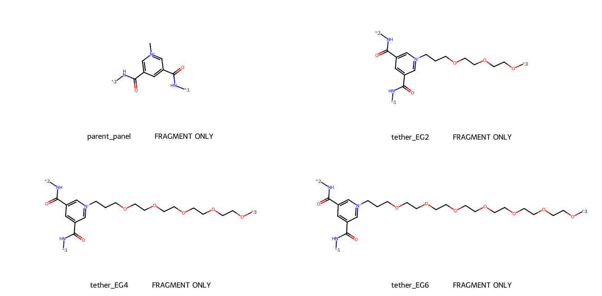
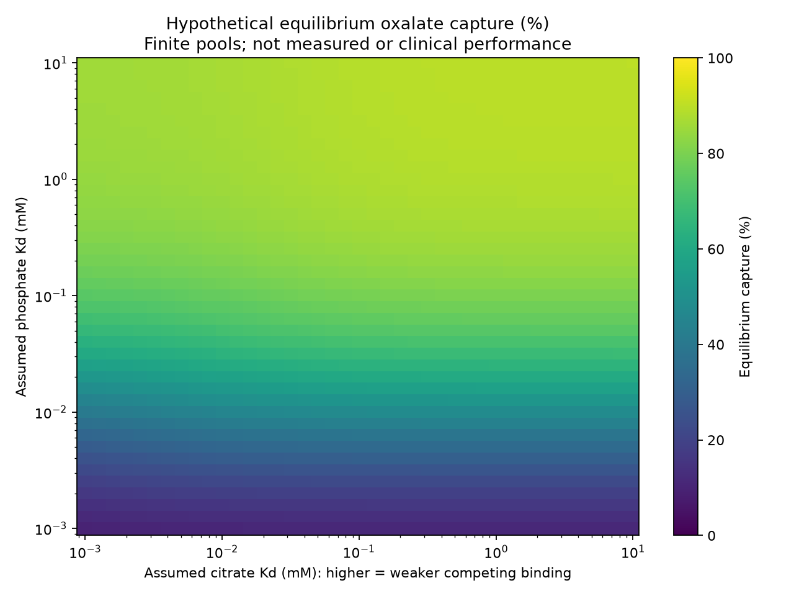

# Research cycle 4 — molecular-panel designs and finite-pool competition

**10 November 2026 | Exploratory computational research; no new medicine established**

## Summary
This cycle adds two concrete outputs:
1. A machine-readable, valence-checked series of **local cage-panel fragments**, showing proposed short, medium and long attachment tethers.
2. A **finite-pool, multiple-ligand equilibrium model** that explicitly counts bound oxalate, chloride, sulfate, phosphate and citrate rather than treating competitors as inexhaustible reservoirs.

The main result is a trade-off: more binding sites improve hypothetical oxalate capture but can increase unwanted phosphate/citrate removal. The design objective should therefore include selectivity and off-target binding—not simply maximize capture.

**No affinity has been calculated from the designed structures.** Fragment validation and equilibrium simulation are separate workstreams. Neither proves efficacy, safety, novelty, synthesis feasibility or a clinical success rate.

## 1. Additional literature findings
### Published TPPC starting point
The published TPPC³⁺ bicyclic amide cage remains the starting scaffold. The paper describes strong oxalate binding, structural preorganization, and sulfate competition in its chemical catalysis experiments. Its apparent affinity measurements are not digestive-fluid constants or intrinsic constants for a tethered derivative. [S1]

The paper's permanganate-mediated oxalate oxidation is **not** a proposed medical treatment here. Chemical catalysis under those conditions must not be confused with a safe gut oxalate-degradation mechanism.

### Immobilization can change both access and binding
A 2024 Nature Communications paper on a different, metal-containing cage/polymer system reports that swelling affects guest-uptake kinetics and binding thermodynamics of immobilized cages. This is an analogy supporting a need to test immobilization effects, not evidence that our organic cage derivative works or is safe. We are not proposing its iron coordination cage as a medicine. [S2]

### A more rigid cavity does not automatically mean better oxalate selectivity
A 2025 study describes preorganization improving anion binding in a different hexacationic cage, including recognition of chloride in water. This reinforces a caution: increasing general anion affinity might increase unwanted competition rather than selectively improve oxalate capture. It does not establish an oxalate-specific modification for TPPC. [S3]

### Research gaps retained
The targeted search did not supply a matched set of phosphate/citrate binding data for our proposed tethered TPPC derivative. This is not proof that no such work exists. Searches are not an exhaustive patent review or systematic literature review.

## 2. More concrete molecular design
### Designs made
A local 3,5-dicarboxamide pyridinium panel was encoded with attachment-point labels:
- `*:1` and `*:2`: unresolved continuation into the original cage;
- `*:3`: unresolved attachment to a support.

Four fragment records are supplied:
| Label | Pyridinium N substituent | Intended role |
|---|---|---|
| parent_panel | Methyl | Local reference, not the complete published cage |
| tether_EG2 | Propyl–O–two ethylene-glycol units–O–attachment | Short-tether hypothesis |
| tether_EG4 | Propyl–O–four ethylene-glycol units–O–attachment | Medium-tether hypothesis |
| tether_EG6 | Propyl–O–six ethylene-glycol units–O–attachment | Long-tether hypothesis |

The design intends to modify only one cage panel, retain the other two parent N-methyl substituents, and preserve the six amide NH donors of the complete cage. The local fragment files do not encode that complete cage closure or the crosslinked support.

**Files:** `cage_panel_fragments.svg`, `fragment_designs.json`, `panel_fragments.sdf`.



### What chemical validation means here
RDKit parsed and sanitized all four fragment graphs; each has formal charge +1 for the local panel. This checks the encoded graph and basic valence rules. It does **not** establish the complete cage's charge/topology, conformational integrity, attachment orientation, synthetic accessibility, stability, affinity, selectivity or safety. Dummy atoms are unresolved connections, not real atoms.

No molecular weight or drug-likeness claim is made for these incomplete fragments. No new full-cage SMILES or validated three-dimensional derivative is supplied. These are useful design inputs for a chemist, not finished medicinal compounds.

### Why this series?
- A short tether might keep loading high but make cavity access more sensitive to the support surface.
- A longer tether might separate the cavity from the surface but add mass/flexibility and permit folding or unwanted interactions.
- The medium tether provides an intermediate comparator; it is not a demonstrated optimum.

Those are design hypotheses. Linker length is **not mapped to a predicted binding constant** in the simulation.

## 3. Improved competition calculation
### Why change the model?
Earlier models treated competing ligands as fixed-concentration reservoirs. When many binding sites are added, that approximation can hide how much competitor is removed. This cycle solves finite ligand pools and explicitly reports phosphate/citrate depletion.

This is a separate equilibrium diagnostic—not an upgrade that retains all previous digestion features. It does not include time, absorption, staged pH, downstream retention, or urinary reduction. More complete chemistry in one respect does not make the entire model physiological.

### Equations
For each ligand i:

`bound_i = total_i * s / (Kd_i + s)`

`total_sites = s + sum(bound_i)`

Here s is free pocket concentration. The program finds s by 100 bisection iterations. All concentrations and Kd values are mM. Each independent shared pocket binds one ligand in this simplified model.

Total ligand concentrations are finite. Ligand mass balance follows from `free_i = total_i - bound_i`. The model assumes a single common pocket population and ignores additional nonspecific sites, ion activities, protonation, counterion exchange complexity, precipitation, multivalent stoichiometry and pocket interactions.

### Scenario assumptions
30,000 shared scenarios, seed 20261115. All sampled ranges are exploratory assumptions, not population distributions or fitted properties of the fragments.

| Input | Range and sampling |
|---|---|
| Volume | 0.2–1 L, uniform |
| Accessible oxalate amount | 0.1–1.5 mmol, log-uniform |
| Chloride concentration | 50–150 mM, uniform |
| Sulfate concentration | 0.1–5 mM, log-uniform |
| Phosphate concentration | 1–20 mM, log-uniform |
| Citrate concentration | 0.1–5 mM, log-uniform |
| Oxalate Kd surrogate | 0.0005–0.05 mM, log-uniform |
| Chloride Kd surrogate | 0.5–5 mM, log-uniform |
| Sulfate Kd surrogate | 0.01–0.5 mM, log-uniform |
| Unknown phosphate/citrate Kd | 0.001–10 mM each, log-uniform |
| Accessible fraction of nominal pockets | 0.5–1, log-uniform |
| Nominal pocket amounts compared | 0.5, 2, 4 mmol |

The oxalate/chloride/sulfate ranges are source-inspired surrogates broadened for exploration, not statistically derived confidence ranges. Published TPPC apparent affinities include counterion/solvent effects and cannot simply be used as jointly fitted intrinsic constants. No claim is made that this model reproduces the paper's measurements. The unknown phosphate/citrate ranges are particularly influential assumptions.

Pocket amounts are not human doses. Material mass requires measured accessible pockets per gram, full formulation composition and a physiological exposure model.

## 4. Results: capacity versus off-target removal
All results are hypothetical equilibrium outputs—not experiments. Percentiles describe the assumed scenarios, not confidence intervals.

| Nominal pockets | Median oxalate capture | Scenarios with ≥70% capture | Median phosphate depletion | Median citrate depletion |
|---|---:|---:|---:|---:|
| 0.5 mmol | 21.07% | 6.46% | 1.68% | 1.44% |
| 2 mmol | 62.71% | 42.67% | 9.16% | 8.71% |
| 4 mmol | 83.70% | 66.00% | 20.63% | 21.12% |

For 4 mmol nominal pockets, the 10th–90th percentile of oxalate capture was 31.94–98.18%. Phosphate and citrate depletion varied widely as well: 1.13–83.26% and 0.60–91.67%, respectively.

### A multi-objective engineering check
We counted scenarios meeting all three conditions:
- at least 70% equilibrium oxalate capture;
- no more than 10% phosphate depletion;
- no more than 10% citrate depletion.

| Nominal pockets | Fraction meeting all three |
|---|---:|
| 0.5 mmol | 4.24% |
| 2 mmol | **12.10%** |
| 4 mmol | 9.13% |

The 10% limits are **illustrative engineering constraints, not validated safety thresholds**. Binding in a mixture does not directly establish nutritional deficiency or patient harm. The point is that the highest-capacity design is not necessarily best when off-target capture is included. None is a validated optimum or recommendation.

## 5. Decision map for missing selectivity data
`competition_decision_map.png` shows modeled oxalate capture as assumed phosphate and citrate Kd values vary from 0.001 to 10 mM. Fixed conditions:
- 0.5 L volume;
- 0.5 mmol oxalate;
- 2 mmol accessible pockets;
- chloride 100 mM, sulfate 1 mM, phosphate 10 mM, citrate 1 mM;
- oxalate Kd 0.005 mM; chloride Kd 1000/589 mM; sulfate Kd 0.05 mM.

These constants are hypothetical intrinsic surrogates. The map is not calibrated to TPPC or its derivatives.



**Meaning:** a candidate needs not only strong oxalate binding, but sufficiently weak competing binding at realistic relative concentrations. The map identifies measurements that could change a go/no-go decision. It does not identify which tether actually supplies that selectivity.

## 6. Computational tests actually performed
- RDKit parsing/sanitization of four local fragments.
- Fragment formal-charge checks.
- Site-conservation and physical bound checks in all simulated equilibria; maximum site-balance error about 7.1 × 10^-15 mM.
- Zero-binding-site control: zero binding.
- Zero-ligand control: zero binding.
- Strong isolated-ligand limit: expected capacity-limited binding recovered.

An initial solver test at extremely small Kd exposed inadequate precision with 60 bisection iterations. The solver was changed to 100 iterations and the full script rerun successfully. This is numerical testing, not experimental validation.

## 7. What should be improved next?
**Priority 1 — fully specify and verify the complete derivative.** Reconstruct the complete published cage from authoritative structural data, choose an attachment chemistry and support, and assess whether the proposed N-substitution preserves the cavity. Fragment graphs alone cannot answer that.

**Priority 2 — obtain matched competitor data.** Measure parent and tethered derivatives under matched chloride/sulfate/phosphate/citrate conditions, with validated free/bound assays. Do not infer tenfold selectivity from a PEG layer.

**Priority 3 — optimize multiple objectives.** Compare capture, retained capture through transit, accessible capacity per gram, off-target binding, swelling, leaching and manufacturability. Avoid optimizing oxalate capture in isolation.

**Priority 4 — validate a molecular calculation before using it to rank derivatives.** An aqueous host–guest free-energy model needs full structures, correct charges, ions/water, appropriate parameterization and calibration against parent measurements. Generic protein docking and vacuum electrostatics would not be reliable substitutes.

**Priority 5 — then connect to the digestion model.** Use measured or validated parameters, quantify uncertainty, and test predictions on independent materials/mixtures before estimating changes in absorption. Clinical efficacy remains a separate question.

## Verdict
This cycle delivers more explicit chemical design fragments, a finite-pool competition model and a clearer multi-objective design requirement. It does **not** deliver a complete new molecule, validated 70% efficacy, a clinical success rate or a breakthrough. The bottleneck is now clearer: selective retention without excessive competing binding, achieved in a fully defined and stable material.

## Reproduction and files
Requires Python, NumPy, RDKit and Matplotlib. Run:
```
python design_and_simulate.py
```
- `fragment_designs.json`: canonical, mapped fragment SMILES.
- `panel_fragments.sdf`: two-dimensional local fragments with dummy attachment atoms.
- `cage_panel_fragments.svg`: structural design sheet.
- `cycle4_results.json`: summaries and numerical checks.
- `capture_scenarios.csv`: 30,000 outputs for each pocket-amount comparison.
- `decision_map_capture_percent.csv` and `decision_map_axes.json`: decision-map data and axes.
- `competition_decision_map.png`: annotated map.

## Sources
[S1] Xu et al., Chemical Science (2024), DOI 10.1039/D4SC05236F: https://pubs.rsc.org/en/content/articlehtml/2024/sc/d4sc05236f

[S2] Coordination cages integrated into swelling poly(ionic liquid)s for guest encapsulation and separation, Nature Communications (2024): https://www.nature.com/articles/s41467-024-48135-1

[S3] Conformationally Preorganized Cage Enables Enhanced Anion Binding in Water, Organic Letters (2025), DOI 10.1021/acs.orglett.5c03094, abstract: https://pubmed.ncbi.nlm.nih.gov/40934377/
