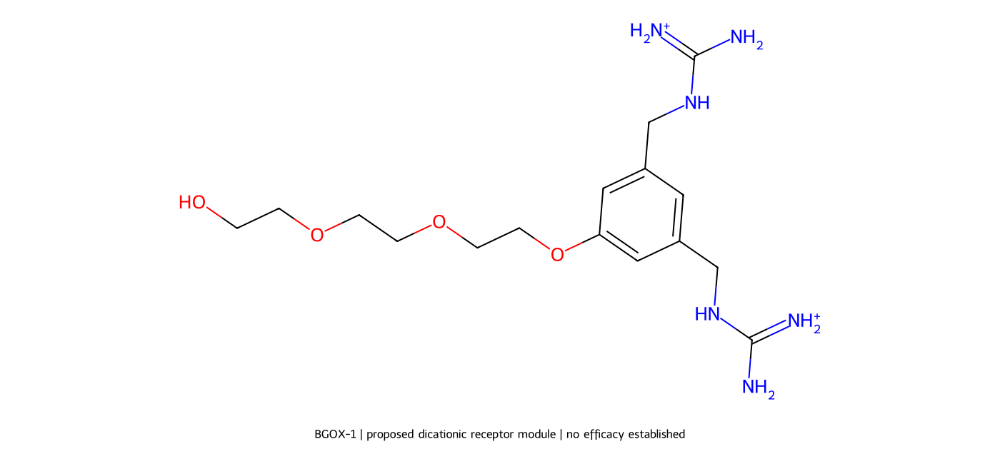

# BGOX-1: a concrete molecular research candidate

**Status: hypothetical small receptor module—not a medicine and not a demonstrated solution to the 80% simulation target.**

## What has actually been designed
A complete small-molecule graph, rather than the previous dummy-atom cage fragments. BGOX-1 is a working label, not an established compound name or a novelty claim.

It consists of:
- a 1,3,5-substituted benzene scaffold;
- two guanidiniomethyl arms represented as positively charged guanidinium groups;
- one triethylene-glycol-derived chain ending in an OH attachment handle.

**Exact canonical SMILES:**
```
NC(=[NH2+])NCc1cc(CNC(N)=[NH2+])cc(OCCOCCOCCO)c1
```

**Formula of the encoded dication:** C16H30N6O4²⁺  
**Formal charge:** +2  
**Calculated molecular mass, excluding counterions:** 370.454 g/mol  
**An explicit dichloride-salt representation:**
```
NC(=[NH2+])NCc1cc(CNC(N)=[NH2+])cc(OCCOCCOCCO)c1.[Cl-].[Cl-]
```

The SMILES is the authoritative identity for this proposal. It fixes the encoded connectivity and charge representation; aqueous protonation equilibria, ion pairing, counterion behavior and solid form have not been determined.



## Why these features?
| Part | Intended role | Important uncertainty |
|---|---|---|
| Two guanidinium-containing arms | Investigate paired charge-assisted hydrogen bonding to oxalate | May bind phosphate/sulfate/citrate instead; water competes strongly |
| Aromatic scaffold | Hold the arms at defined substitution positions | Does not rigidly orient their terminal binding groups into a selective cavity |
| Methylene connections | Permit arm reorientation | Flexibility can undermine preorganization and selectivity |
| Ether-rich side chain | Supply a hydrated spacer | Does not establish safety, nonabsorption or selective rejection of competing small ions |
| Terminal OH | A possible future covalent-attachment handle | Full attachment chemistry, support and resulting accessible capacity remain unspecified |

These are **design intentions**, not demonstrated functions.

## Why this is different from the previous TPPC direction
This is a **simpler alternative screening receptor**, not an exact reconstruction or validated derivative of the published TPPC cage. It was selected so that an unambiguous complete small receptor graph could be supplied without inventing an unverified full-cage topology. It sacrifices the cage's preorganization and may perform worse. No superiority over TPPC or the previously proposed fragments is claimed.

A faithful TPPC-based candidate remains a separate task requiring verification of the parent atom-level structure and complete derivative topology. This design does not solve that task by relabeling an incomplete cage.

## Computational work actually performed
1. RDKit parsing and chemical sanitization of the full receptor graph.
2. Verification that the receptor is a single connected molecular component with formal charge +2.
3. Formula/mass calculation from the encoded graph.
4. Two-dimensional drawing and SDF export.
5. Thirty requested three-dimensional embedding trials using ETKDGv3, with RMS pruning, followed by MMFF optimization of the generated conformers.
6. Export of the generated conformers and optimization statuses.

The guanidinium central-carbon separation among generated, optimized conformers was approximately **8.16–9.55 Å**. This is only a geometric observation from an isolated-molecule model. It does not demonstrate a suitable oxalate pocket, simultaneous two-arm binding, or the aqueous conformational ensemble. The spacing and flexibility are concerns to investigate, not evidence of successful recognition.

MMFF energies must NOT be interpreted as binding energies, aqueous free energies, toxicity predictions or efficacy scores. The conformer set is not exhaustive and explicit water, counterions and guest molecules were not included.

## What we cannot claim
- No 80% capture prediction is assigned to BGOX-1.
- No binding constant or phosphate/citrate selectivity has been calculated or measured.
- No evidence supports the 100-fold stronger oxalate affinity or 100-million-fold weaker competitor binding used in the passing parameter study.
- No synthesis feasibility, chemical novelty, patentability or freedom to operate is established.
- This small receptor is not proven gut-retained; charge or a PEG-like chain does not demonstrate nonabsorption.
- It is not the final crosslinked therapeutic material.
- No cell, animal, human or digestive-mixture experiment has been conducted.

**Do not make, ingest or administer it based on this proposal.**

## What would decide whether it deserves further work?
First, qualified chemists should review identity, feasibility and known prior art. A validated explicit-solvent host–guest method could then compare oxalate, phosphate, sulfate, citrate and chloride binding for this defined receptor and appropriate controls, calibrated against experimental references. Given the flexibility and measured-in-model arm separation, this candidate could fail early; it should not be presumed a lead compound.

Only measured or validated binding properties should be inserted into the equilibrium/digestion models. Practical support attachment, impurity control, swelling, leaching, absorption and safety would require separate development.

## Files
- `BGOX-1.smiles`: exact receptor SMILES.
- `BGOX-1_2D.sdf`: complete receptor module with 2D coordinates.
- `BGOX-1_conformers.sdf`: generated isolated-molecule 3D conformers.
- `BGOX-1_design.json`: descriptors, conformer results and limitations.
- `BGOX-1_structure.png`: structure drawing.
- `build_candidate.py`: reproducible generation script; requires RDKit and NumPy.

## Relevant background, not validation of BGOX-1
Published TPPC cage and aqueous binding work: https://pubs.rsc.org/en/content/articlehtml/2024/sc/d4sc05236f

General guanidinium receptor literature discusses aqueous-solvation challenges and binding of multiple oxoanions: https://www.researchgate.net/publication/6539465_Molecular_recognition_of_oxoanions_based_on_guanidinium_receptors

A targeted search is not a novelty search. No source is cited as experimental evidence for BGOX-1, because none was established in this work.
